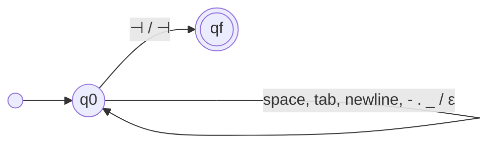
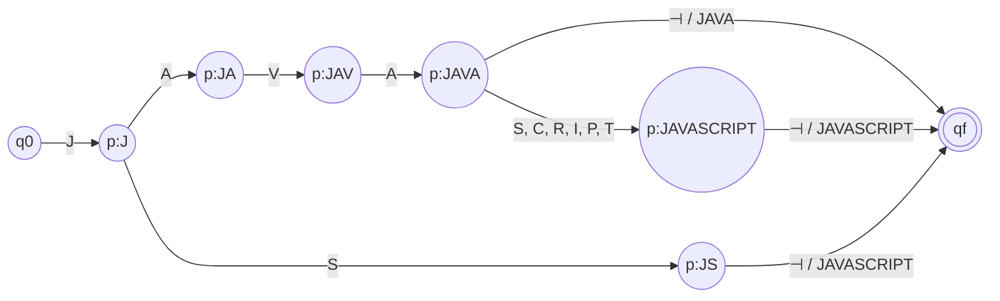
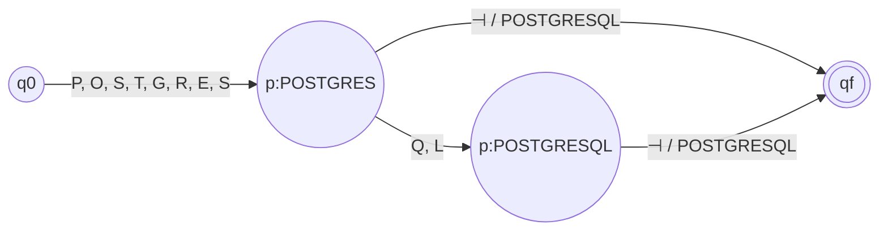

# Stage 2 — Normalization with finite-state transducers

This stage converts the literal mentions from stage 1 (`JS`, `React.js`, `scikit learn`, `Machine-learning model development`…) into canonical tokens (`JAVASCRIPT`, `REACT`, `SCIKIT_LEARN`, `ML_MODEL_DEVELOPMENT`…).

## Scope

- **Input:** the `value` of each match in `skills` and `other_qualifications` (46 possible tokens; see `normalization/catalog.py`). Contact data, degrees, and years of experience have no equivalences to normalize and are left out.
- **Output:** canonical tokens without duplicates, unrecognized values and, if a profile is given, the tokens in the profile's canonical order.
- **Pipeline:** `value → T1 (cleaning) → T2 (alias → token) → deduplicate → sort by profile`. Only T1 and T2 are transducers; deduplicating and sorting are application logic (`pipeline.py`, `profiles.py`).

## Design decisions

1. **Character-level tokenization.** The states of T2 represent prefixes already read, not a disguised dictionary.
2. **End marker `⊣`.** Several aliases are prefixes of others (`Java`/`JavaScript`, `SQL`/`SQLite`/`SQL Server`, `React`/`ReactJS`). `⊣` is added to Σ and the output is emitted only when it is consumed; this way the translation depends on the whole string and not on a prefix.
3. **Two transducers.** T1 absorbs variations in case, spaces, and separators (`React.js`, `ReactJS`, and `react js` converge on `REACTJS`), which keeps T2 small.
4. **Explicit rejection.** A string outside the model has no translation: the value goes to `unrecognized` and does not reach stage 3.
5. **Catalog as the single source of truth.** T2 is generated from `CATALOG`; an ambiguous alias raises `ValueError` when it is built.
6. **δ and ω in pyformlang.** The library stores the output on the transition, so δ and ω are implemented as a single function `Q × Σ → Q × Γ*`. In the 7-tuple, ω is its projection onto the output.

## T1 — Cleaning transducer

```text
M1 = (Q, Σ, Γ, δ, ω, q0, F)
Q  = {q0, qf}
Σ  = {A..Z, a..z, +, #, ' ', \t, \r, \n, '-', '.', '_', ⊣}
Γ  = {A..Z, +, #, ⊣}
δ  = {(q0, x, q0) | x ∈ letters ∪ {+, #} ∪ separators} ∪ {(q0, ⊣, qf)}
ω  = {(q0, a, q0) ↦ A | a ∈ {a, A}, for each letter}       # to uppercase
   ∪ {(q0, x, q0) ↦ x | x ∈ {+, #}}                        # kept
   ∪ {(q0, s, q0) ↦ ε | s ∈ separators}                    # removed
   ∪ {(q0, ⊣, qf) ↦ ⊣}
q0 = q0
F  = {qf}
```



Example: `Scikit-learn⊣` → `SCIKITLEARN⊣`; `Spring \n Boot⊣` → `SPRINGBOOT⊣`.

## T2 — Alias-to-canonical-token transducer

It is built as a *trie* over the cleaned keys (catalog aliases passed through T1). With the current catalog it has 359 states and 419 transitions.

```text
M2 = (Q, Σ, Γ, δ, ω, q0, F)
K  = {clean(alias) | alias ∈ CATALOG}  with clean = T1 without ⊣      # keys
Q  = {q0, qf} ∪ {p_w | w non-empty proper prefix of some k ∈ K} ∪ {p_k | k ∈ K}
Σ  = {A..Z, +, #, ⊣}
Γ  = {the 46 canonical tokens}
δ  = {(p_w, c, p_wc) | wc prefix of some k ∈ K}  (with p_ε = q0)
   ∪ {(p_k, ⊣, qf) | k ∈ K}
ω  = {(p_w, c, p_wc) ↦ ε}  ∪  {(p_k, ⊣, qf) ↦ token(k)}
q0 = q0
F  = {qf}
```

Fragment for `JAVA` / `JAVASCRIPT` / `JS` (the common prefix does not interfere thanks to `⊣`):



Fragment for `POSTGRES` / `POSTGRESQL`:



## Canonical order per profile

`profiles.py` defines an ordered list of groups for each profile; tokens are sorted by (group, position in the group). Tokens that the profile does not cover are returned separately in `outside_profile` and are not sent to the automaton. So `Git, NodeJS, JS, Postgres, React.js` produces `JAVASCRIPT, REACT, NODE_JS, POSTGRESQL, GIT`.

| Profile | Group order |
| --- | --- |
| Full Stack | frontend (language, framework) → backend → API → database → version control |
| Machine Learning | Python → Pandas/NumPy → Scikit-learn/TensorFlow/PyTorch → ML model development → SQL/PostgreSQL → Git |
| DevOps | Linux → Python → Docker → Kubernetes → AWS/Azure/GCP → Git |
| Data Engineer | Python/Java → SQL → Pandas/NumPy → database → data-processing pipelines → AWS/Azure/GCP → Git |

DevOps and Data Engineer are the team's own profiles; both only use technologies already in `CATALOG`. A new profile is added as a new entry in `PROFILES`, and any new technologies as entries in `CATALOG` (and in `patterns.py`, if stage 1 does not detect them yet).

## Running and tests

```powershell
python -m pip install -e .
python -m resumelens .\resume.txt --normalize --profile full_stack
python -m unittest discover -s tests -v
```

`tests/test_normalization.py` covers the examples, every catalog alias, case and spaces, prefixes, `C++`/`C#`, rejection of unknown values, equivalence of T1 with the pure-Python cleaning, deduplication, independence from input order, and that every value in the stage 1 dataset is normalized.

## Limitations

- T1's Σ is ASCII; a character outside Σ (for example a digit) causes the value to be rejected.
- `SQL Server` produces two mentions in stage 1 (`SQL` and `SQL Server`), and stage 2 normalizes them to `SQL` and `SQL_SERVER`. Deciding whether they count as `SQL` belongs to stage 3 (or to fixing the stage 1 pattern).
- The profile ordering assumes one token per group; if a résumé lists `Pandas` and `NumPy`, both appear consecutively and the automaton must allow it.
- The catalog is closed: a technology that is not listed is reported as unrecognized.
