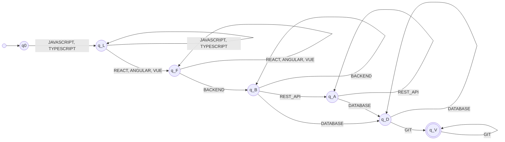
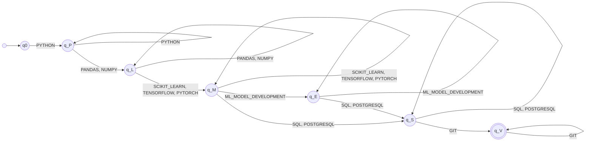
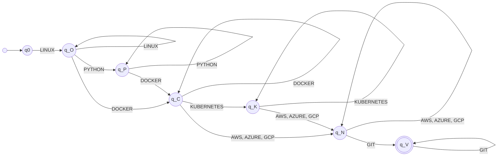
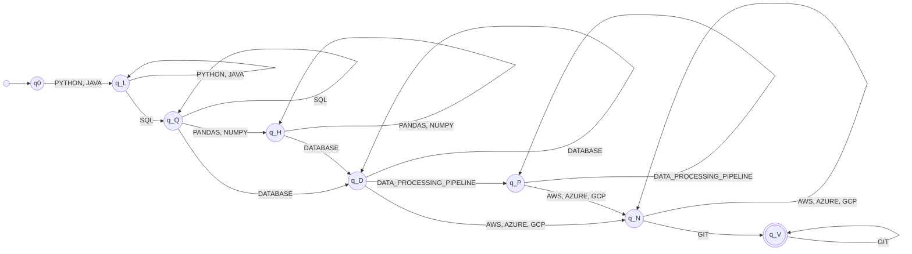

# Stage 3 — Profile pattern recognition with finite automata

This stage decides whether the canonical tokens produced by stage 2 (`JAVASCRIPT`, `REACT`, `NODE_JS`, `POSTGRESQL`, `GIT`…) satisfy the qualification pattern of a professional profile. Each profile is modeled with a deterministic finite automaton (DFA) implemented with `pyformlang`, and the result is `ACCEPTED` or `REJECTED`.

## Scope

- **Input:** the list of canonical tokens from `normalize_text(text).tokens` (or a list of tokens written directly).
- **Output:** one result per profile with the evaluated sequence, the tokens outside the profile, the DFA state path, and the verdict.
- **Pipeline:** `tokens → deduplicate → sort by profile (dropping tokens outside it) → DFA → ACCEPTED / REJECTED`. Only the last step is the automaton; deduplicating and sorting are application logic (`profiles.py`).
- **Profiles:** Full Stack Developer and Machine Learning Engineer (from the assignment), DevOps Engineer (software engineering, defined by the team), and Data Engineer (AI/data, defined by the team).

The verdict only states whether the qualifications **written** in the résumé form a word of the profile's language. It does not measure proficiency, rank candidates, or recommend hires.

## Design decisions

1. **From set to word.** A résumé mentions skills in any order; an automaton reads words. Before the DFA, `sort_tokens` sorts the tokens by (group, position in the group) according to `ProfileSpec`, so `Git, AWS, Docker, Linux` and `Linux, Docker, AWS, Git` produce the same word `LINUX DOCKER AWS GIT`. The DFA only needs to recognize the canonical order, which keeps it small.
2. **Tokens outside the profile.** Tokens the profile does not cover (for example `DOCKER` in Full Stack) are reported in `outside_profile` and are not sent to the automaton. Having additional skills does not make a résumé fail.
3. **One state per group.** Each profile group (language, framework, database…) has a state `q_X` meaning "at least one token of this group has been read". Self-loops allow several tokens from the same group (for example `PANDAS NUMPY`).
4. **Optional groups.** An optional group is skipped with a direct transition from the previous state to the next one. This makes `REST_API` optional in Full Stack, as in the assignment example (`JS, React.js, NodeJS, Postgres, Git`), and `ML_MODEL_DEVELOPMENT` optional in ML, as in the example in section 6.2 (`PYTHON, PANDAS, TENSORFLOW, POSTGRESQL, GIT`).
5. **Complete DFA with a sink state.** Σ is the full catalog of canonical tokens (46). Every undefined transition goes to `q_dead`, which is not accepting and loops to itself on every symbol. So δ is a total function `Q × Σ → Q`. A token that is not in Σ also takes the run to `q_dead`.
6. **Transitions as data.** Each module declares `TRANSITIONS` as tuples `(source, token group, target)` taken from `ProfileSpec`. `build_*_dfa()` expands them into the full table over `CATALOG` and caches it with `lru_cache`.
7. **A single accepting state.** Every profile ends in `GIT`, so `F = {q_V}`.

### Automaton type

All four automata are **DFAs**:

- For every pair `(q, a) ∈ Q × Σ` there is **exactly one** target state (missing transitions are completed toward `q_dead`).
- There are no ε/λ-transitions.
- There is a single initial state `q0`.

`pyformlang` confirms it with `dfa.is_deterministic() == True`. In addition, `dfa.minimize()` returns the same number of states in all four cases, so the automata are already minimal.

| Profile | Module | \|Q\| | \|Σ\| | Transitions (\|Q\|·\|Σ\|) |
| --- | --- | --- | --- | --- |
| Full Stack Developer | `recognition/full_stack.py` | 8 | 46 | 368 |
| Machine Learning Engineer | `recognition/ml_engineer.py` | 8 | 46 | 368 |
| DevOps Engineer | `recognition/devops.py` | 8 | 46 | 368 |
| Data Engineer | `recognition/data_engineer.py` | 9 | 46 | 414 |

The tables and diagrams below omit the transitions to `q_dead`: any pair `(q, a)` that is not listed goes to `q_dead`, and `δ(q_dead, a) = q_dead` for every `a ∈ Σ`.

## M1 — Full Stack Developer

### Pattern

```text
(JAVASCRIPT | TYPESCRIPT)+ (REACT | ANGULAR | VUE)+ BACKEND+ REST_API* DATABASE+ GIT+
BACKEND  = NODE_JS | DJANGO | SPRING_BOOT | FLASK | FASTAPI | EXPRESS
DATABASE = POSTGRESQL | MYSQL | SQLITE | MONGODB | REDIS | ORACLE | SQL_SERVER
```

A Full Stack Developer must have a frontend language, a frontend framework, a backend technology, at least one database (SQL or NoSQL), and Git. `REST_API` is optional.

### Formal definition

```text
M1 = (Q, Σ, δ, q0, F)
Q  = {q0, q_L, q_F, q_B, q_A, q_D, q_V, q_dead}
Σ  = canonical tokens in CATALOG (46)
q0 = q0
F  = {q_V}
```

| δ | Tokens | Target |
| --- | --- | --- |
| q0 | JAVASCRIPT, TYPESCRIPT | q_L |
| q_L | JAVASCRIPT, TYPESCRIPT | q_L |
| q_L | REACT, ANGULAR, VUE | q_F |
| q_F | REACT, ANGULAR, VUE | q_F |
| q_F | BACKEND | q_B |
| q_B | BACKEND | q_B |
| q_B | REST_API | q_A |
| q_B | DATABASE | q_D |
| q_A | REST_API | q_A |
| q_A | DATABASE | q_D |
| q_D | DATABASE | q_D |
| q_D | GIT | q_V |
| q_V | GIT | q_V |



### Example

```text
Input:    JS, React.js, NodeJS, Postgres, Git.
Sequence: JAVASCRIPT REACT NODE_JS POSTGRESQL GIT
Path:     q0 → q_L → q_F → q_B → q_D → q_V
Output:   ACCEPTED
```

## M2 — Machine Learning Engineer

### Pattern

```text
PYTHON+ (PANDAS | NUMPY)+ (SCIKIT_LEARN | TENSORFLOW | PYTORCH)+ ML_MODEL_DEVELOPMENT* (SQL | POSTGRESQL)+ GIT+
```

A Machine Learning Engineer must have Python, a data library, an ML framework, SQL (or PostgreSQL as a SQL engine), and Git. The phrase "machine-learning model development" is optional because the assignment example does not include it and must still be accepted.

### Formal definition

```text
M2 = (Q, Σ, δ, q0, F)
Q  = {q0, q_P, q_L, q_M, q_E, q_S, q_V, q_dead}
Σ  = canonical tokens in CATALOG (46)
q0 = q0
F  = {q_V}
```

| δ | Tokens | Target |
| --- | --- | --- |
| q0 | PYTHON | q_P |
| q_P | PYTHON | q_P |
| q_P | PANDAS, NUMPY | q_L |
| q_L | PANDAS, NUMPY | q_L |
| q_L | SCIKIT_LEARN, TENSORFLOW, PYTORCH | q_M |
| q_M | SCIKIT_LEARN, TENSORFLOW, PYTORCH | q_M |
| q_M | ML_MODEL_DEVELOPMENT | q_E |
| q_M | SQL, POSTGRESQL | q_S |
| q_E | ML_MODEL_DEVELOPMENT | q_E |
| q_E | SQL, POSTGRESQL | q_S |
| q_S | SQL, POSTGRESQL | q_S |
| q_S | GIT | q_V |
| q_V | GIT | q_V |



### Examples

```text
Input:    PYTHON, PANDAS, TENSORFLOW, POSTGRESQL, GIT      (section 6.2 of the assignment)
Path:     q0 → q_P → q_L → q_M → q_S → q_V
Output:   ACCEPTED

Input:    Python, Pandas, NumPy, Scikit-learn, TensorFlow, SQL, Git.
Sequence: PYTHON PANDAS NUMPY SCIKIT_LEARN TENSORFLOW SQL GIT
Path:     q0 → q_P → q_L → q_L → q_M → q_M → q_S → q_V
Output:   ACCEPTED
```

## M3 — DevOps Engineer (the team's software engineering profile)

### Pattern

```text
LINUX+ PYTHON* DOCKER+ KUBERNETES* (AWS | AZURE | GCP)+ GIT+
```

A DevOps Engineer operates and deploys systems: they must know Linux, containers (Docker), at least one public cloud, and Git. Python (as a scripting language) and Kubernetes (orchestration) are optional. The profile only uses tokens that stages 1 and 2 already recognize.

### Formal definition

```text
M3 = (Q, Σ, δ, q0, F)
Q  = {q0, q_O, q_P, q_C, q_K, q_N, q_V, q_dead}
Σ  = canonical tokens in CATALOG (46)
q0 = q0
F  = {q_V}
```

| δ | Tokens | Target |
| --- | --- | --- |
| q0 | LINUX | q_O |
| q_O | LINUX | q_O |
| q_O | PYTHON | q_P |
| q_O | DOCKER | q_C |
| q_P | PYTHON | q_P |
| q_P | DOCKER | q_C |
| q_C | DOCKER | q_C |
| q_C | KUBERNETES | q_K |
| q_C | AWS, AZURE, GCP | q_N |
| q_K | KUBERNETES | q_K |
| q_K | AWS, AZURE, GCP | q_N |
| q_N | AWS, AZURE, GCP | q_N |
| q_N | GIT | q_V |
| q_V | GIT | q_V |



### Examples

```text
Input:    Git, AWS, Docker, Kubernetes, Linux, Python.
Sequence: LINUX PYTHON DOCKER KUBERNETES AWS GIT
Path:     q0 → q_O → q_P → q_C → q_K → q_N → q_V
Output:   ACCEPTED

Input:    Linux, Docker, Kubernetes, Git          (no cloud)
Path:     q0 → q_O → q_C → q_K → q_dead
Output:   REJECTED
```

## M4 — Data Engineer (the team's AI/data profile)

### Pattern

```text
(PYTHON | JAVA)+ SQL+ (PANDAS | NUMPY)* DATABASE+ DATA_PROCESSING_PIPELINE* (AWS | AZURE | GCP)+ GIT+
DATABASE = POSTGRESQL | MYSQL | SQLITE | MONGODB | REDIS | ORACLE | SQL_SERVER
```

A Data Engineer builds and maintains data infrastructure: they must have a programming language (Python or Java), SQL, at least one database engine, at least one cloud, and Git. Pandas/NumPy and the phrase "data-processing pipelines" are optional. Unlike ML Engineer, it does not require ML frameworks, but it does require databases and cloud.

### Formal definition

```text
M4 = (Q, Σ, δ, q0, F)
Q  = {q0, q_L, q_Q, q_H, q_D, q_P, q_N, q_V, q_dead}
Σ  = canonical tokens in CATALOG (46)
q0 = q0
F  = {q_V}
```

| δ | Tokens | Target |
| --- | --- | --- |
| q0 | PYTHON, JAVA | q_L |
| q_L | PYTHON, JAVA | q_L |
| q_L | SQL | q_Q |
| q_Q | SQL | q_Q |
| q_Q | PANDAS, NUMPY | q_H |
| q_Q | DATABASE | q_D |
| q_H | PANDAS, NUMPY | q_H |
| q_H | DATABASE | q_D |
| q_D | DATABASE | q_D |
| q_D | DATA_PROCESSING_PIPELINE | q_P |
| q_D | AWS, AZURE, GCP | q_N |
| q_P | DATA_PROCESSING_PIPELINE | q_P |
| q_P | AWS, AZURE, GCP | q_N |
| q_N | AWS, AZURE, GCP | q_N |
| q_N | GIT | q_V |
| q_V | GIT | q_V |



### Example

```text
Input:    Built data processing pipelines.
          Technical Skills: Python, SQL, Pandas, PostgreSQL, MongoDB, AWS, Git.
Sequence: PYTHON SQL PANDAS POSTGRESQL MONGODB DATA_PROCESSING_PIPELINE AWS GIT
Path:     q0 → q_L → q_Q → q_H → q_D → q_D → q_P → q_N → q_V
Output:   ACCEPTED
```

## Separation between profiles

Each example résumé is accepted only by its own profile:

| Example résumé | Full Stack | ML Engineer | DevOps | Data Engineer |
| --- | --- | --- | --- | --- |
| Wednesday Addams (Full Stack) | **ACCEPTED** | REJECTED | REJECTED | REJECTED |
| Mary Jane Watson (ML) | REJECTED | **ACCEPTED** | REJECTED | REJECTED |
| DevOps (`Git, AWS, Docker, Kubernetes, Linux, Python`) | REJECTED | REJECTED | **ACCEPTED** | REJECTED |
| Data Engineer (M4 example) | REJECTED | REJECTED | REJECTED | **ACCEPTED** |

For example, Mary Jane Watson's résumé is not a Data Engineer résumé because, after `PANDAS NUMPY`, the next token is `DATA_PROCESSING_PIPELINE` without having gone through a database, and the run falls into `q_dead`.

## API

Each module in `src/resumelens/recognition/` exposes the same functions (with the profile name as suffix):

| Function | Description |
| --- | --- |
| `build_<profile>_dfa()` | Builds (once, cached) the `pyformlang` `DeterministicFiniteAutomaton`. |
| `run_<profile>(sequence)` | Returns the state path for an already sorted sequence. |
| `recognize_<profile>(tokens)` | Deduplicates, sorts by profile, evaluates the DFA, and returns the result. |
| `recognize_<profile>_text(text)` | Runs extraction → normalization → recognition on plain text. |

The result is a dataclass with `sequence`, `outside_profile`, `path`, `verdict`, and `profile`, serializable with `to_dict()`:

```python
from resumelens.recognition.ml_engineer import recognize_ml_engineer

result = recognize_ml_engineer(["PYTHON", "PANDAS", "TENSORFLOW", "POSTGRESQL", "GIT"])
print(result.to_dict())
# {'sequence': ['PYTHON', 'PANDAS', 'TENSORFLOW', 'POSTGRESQL', 'GIT'],
#  'outside_profile': [],
#  'path': ['q0', 'q_P', 'q_L', 'q_M', 'q_S', 'q_V'],
#  'verdict': 'ACCEPTED',
#  'profile': 'MACHINE_LEARNING_ENGINEER'}
```

To see the sequence a DFA will receive from the command line, use the stage 2 profile ordering:

```powershell
python -m resumelens .\resume.txt --normalize --profile devops
```

## Extending or adding a profile

1. Add a `ProfileSpec` in `profiles.py` with its groups in canonical order and register it in `PROFILES`.
2. If the profile needs new technologies, add them to `CATALOG` (stage 2) and to `patterns.py` (stage 1).
3. Create a module in `recognition/` with its `TRANSITIONS` list: one state per group, self-loops for groups with several tokens, and direct transitions to skip optional groups.

## Limitations

- `SQL Server` produces two mentions in stage 1 (`SQL` and `SQL Server`), so a résumé that only mentions SQL Server also satisfies the `SQL` group of ML Engineer and Data Engineer. The fix belongs to the `programming_languages` pattern of stage 1.
- The team's profiles only use the current catalog vocabulary. Typical tools such as Jenkins, Terraform, Bash, GitHub Actions (DevOps) or Spark, Airflow, Kafka (Data Engineer), and variants such as `Amazon Web Services`, `Google Cloud`, `k8s`, or `Mongo DB`, are not recognized yet.
- The pattern is an ordered list of requirements: it does not express alternatives between whole groups (for example "Kubernetes **or** cloud experience"). That would require more states or an NFA.
- The verdict depends on explicit mentions; it does not evaluate years of experience, proficiency level, or context.
- There are no automated tests specific to this stage's automata yet, nor a command-line option that runs recognition.
